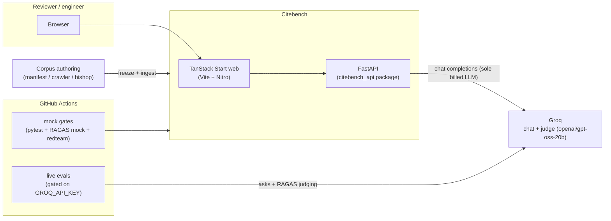
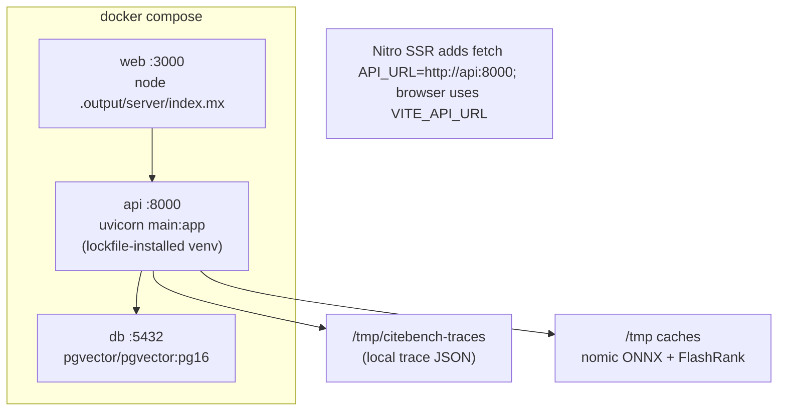
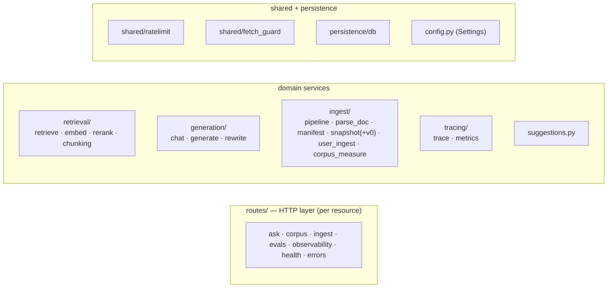
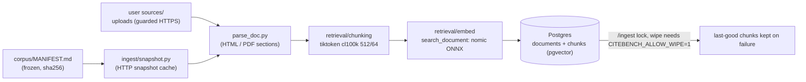
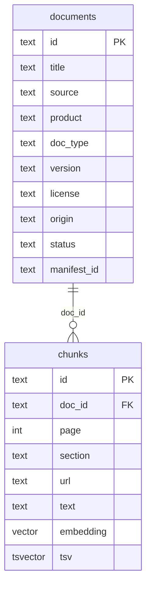
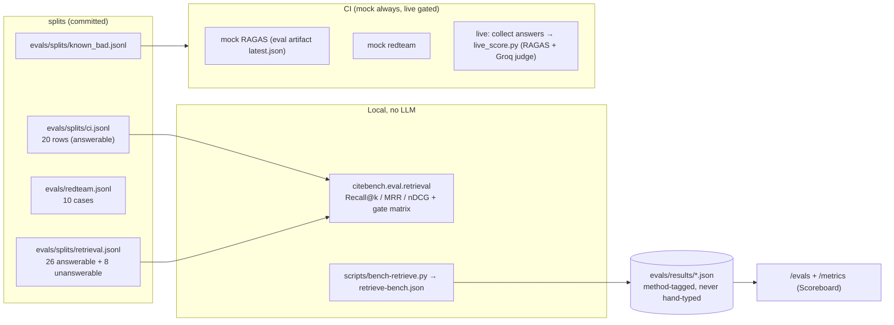

# Citebench Architecture

> A bench, not a chat product. The homepage is an index; the review surfaces are
> Corpus, Playground, Traces, and Evals. For the deep dive on the retriever and
> scoring: [`RETRIEVAL-EVALS.md`](RETRIEVAL-EVALS.md). Living decisions live in
> [`DECISIONS.md`](../DECISIONS.md); per-plan history in
> [`plans/README.md`](../plans/README.md); contracts in
> [`docs/contracts/`](contracts/SYNTHESIS.md).

## Contents

- [System context](#system-context)
- [Runtime topology (compose)](#runtime-topology-compose)
- [API package layering](#api-package-layering)
- [The ask path (retrieve → rerank → generate | abstain)](#the-ask-path)
- [Abstain policy](#abstain-policy)
- [Ingest path](#ingest-path)
- [Data model](#data-model)
- [Observability (traces + metrics)](#observability)
- [Evaluation architecture](#evaluation-architecture)
- [Non-negotiable decisions](#non-negotiable-decisions)
- [Libraries and packages (docs)](#libraries-and-packages)

## System context



- Reviewers ask questions over a **frozen public corpus** (~1,500 Kubernetes,
  Azure, PostgreSQL, FastAPI, xv6 docs; freeze recorded in
  `corpus/MANIFEST.md`, freeze date 2026-09-10).
- Two objectives are measured objectively, not vibes: does retrieval find the
  evidence (Recall@k / MRR / nDCG on hand-labeled qrels), and does the system
  refuse when it cannot (false-answer / false-abstain calibration).

## Runtime topology (compose)



- Browser → Vite dev? No: the served build is `/.output/server/index.mjs`
  on port 3000 (`WEB_PORT` configurable). Browser origins must be allow-listed
  (CORS in `citebench_api/routes/__init__.py::_cors_origins`).
- **Tab loaders call FastAPI directly** with `fetchApiJson`. TanStack
  `createServerFn` for FastAPI GETs is explicitly forbidden: Start's GET RPC
  returns 401/500 on client navigations (CSRF/origin) and is why corpus stats
  and traces once looked broken.

## API package layering

`main.py` is a thin uvicorn entry; everything lives in the **`citebench_api`**
package. Domain logic never imports from `routes/`; routes only translate HTTP
to service calls.



```
apps/api/
  main.py                      # uvicorn entry: create_app() from routes
  citebench_api/
    routes/                    # HTTP layer per resource (__init__ has create_app + CORS + warmup)
    retrieval/                 # retrieve (embed → pgvector/pg_ts → RRF → re-rank), embed, rerank, chunking
    generation/                # chat (Groq), generate (LangGraph path), rewrite (plan 019 flag)
    ingest/                    # frozen-manifest ingest + user sources/uploads
    tracing/                   # RunTrace Span/Prometheus metrics
    persistence/db.py          # Postgres schema + queries
    config.py                  # Settings (config.yaml + env, _env_flag helpers)
    shared/                    # rate limiter, safe-fetch guard
    suggestions.py             # corpus-grounded question suggestions (LLM, cached)
tests/                         # pytest; injected fakes via `*_fn` kwargs, no live DB/LLM
```

## The ask path

`POST /generate` compiles the LangGraph path `START → retrieve → generate | abstain → END`:

1. If `query_rewrite` is on (plan 019, default off) the retrieval query is
   rewritten (1 Groq call, never raises) while prompt/trace keep the user's words.
2. `retrieve()` embeds the query (local nomic ONNX), runs dense (pgvector) and
   lexical (tsv) searches, fuses with Cormack RRF `k=60`, then FlashRank reorders
   the 50-chunk pool and keeps `top_k=8`.
3. Abstainers never call Groq; a generate outcome's citations must be a subset of
   retrieved chunk ids (fabricated ids are dropped). Abstain answers are exactly
   "I don't know".
4. One `RunTrace` per ask (spans: retrieve → rerank → generate | abstain).

```mermaid
sequenceDiagram
    participant W as Web (Playground)
    participant A as FastAPI /generate
    participant R as retrieve()
    participant G as Postgres
    participant F as FlashRank (TinyBERT-L-2)
    participant L as Groq chat

    W->>A: query + optional filters
    A->>R: retrieve(query, config) [if query_rewrite: 1 rewrite call first]
    R->>G: embed search (dense) + tsv (lexical), pooled 50
    G-->>R: dense + lexical lists
    R->>R: RRF fusion k=60
    R->>F: rerank pool (cross-encoder)
    F-->>R: scores → top-8 (fallback: RRF order + rerank_skipped=true)
    alt abstain (empty / low_confidence)
        A-->>W: "I don't know" (no Groq)
    else generate
        A->>L: strict JSON answer + citation_ids
        L-->>A: {abstain, answer, citation_ids}
        Note over A: fabricated ids dropped; ungrounded → abstain
        A-->>W: answer + citations + latency + cost estimate
    end
    A--)A: emit_trace → local store or Langfuse
```

Reranker default (plan 023): **ms-marco-TinyBERT-L-2-v2**, chosen by qrels
ablation (better recall/MRR/nDCG AND ~7× faster than MiniLM-L-12-Q; see
`DECISIONS.md` "Retrieve latency at scale"). `RetrieveConfig` carries
retrieval knobs, meaning `retrieval_mode ∈ hybrid|dense|lexical` and
`rerank_enabled=False` exist so the eval can run config ablations.

## Abstain policy

| Reason | Trigger | Chat call? |
|---|---|---|
| `empty_retrieve` | 0 hits (incl. blank query) | No |
| `low_confidence` | FlashRank ran and top score < `abstain_min_score` (0.12). Skipped while `rerank_skipped` (RRF and FlashRank scores are different scales) | No |
| `out_of_corpus` | Model sets `abstain: true` | Yes |
| `ungrounded` | Model answered but cited nothing the retrieval returned | Yes |

The retrieval-only gate (`top.score ≥ abstain_min_score`) is what the qrels
answerability matrix measures — false-answer (answering the unanswerable) is a
contract violation, false-abstain hides available evidence.

## Ingest path

Frozen crawl (the untouched public corpus): idempotent by sha256, per-record
failures tolerated, `text_ref` = `doc_id#chunk_id`, one chunk's failure never
deletes the last good corpus. User-added sources/uploads (plan 008/020) are
separate namespaces and never mixed into the frozen reference index.



## Data model



- Chunks carry metadata (`doc_id, page, section, url, ...`) used
  both for citations and for plan-017 metadata filters — parameterized SQL
  (`Filters` model: product/doc_type/source/version/license/origin/section/doc_ids).
- Running traces: `retrieve → rerank → generate | abstain` (see below); `/traces` never spills chunk text.

## Observability

- `/traces` (+ `/traces/{run_id}`): one run per ask with span tree
  `retrieve → rerank → generate | abstain`, tokens, latency, cost estimate,
  `rerank_skipped`, failed flags, implicit errors visible in the UI.
- `/metrics?format=json|prometheus`: run counters, latency metrics, `%eval`
  consumers; reads the store without adding a second eval run.
- Langfuse optional: set `LANGFUSE_*` keys to emit; missing → JSONL trace store
  (`TRACE_STORE_DIR`) with the same schema.

## Evaluation architecture



- **Answer gate**: retrieval-gate answerability matrix (false-answer ≤ 0.25 in
  CI; measured 0.000 with the TinyBERT reranker).
- **Faithfulness gate** `≥ 0.7` — mock judge in CI, live RAGAS via
  `scripts/live-evals.sh` (decoupled runtime/eval venvs; ragas conflicts with
  runtime pins, see `apps/api/requirements-eval.txt`).
- Retrieve Latency budget p95 < 400 ms — measured 316 ms (rerank ~100 ms +
  dense scan ~130 ms); ANN stays deferred (`DECISIONS.md`).
- The retrieval confidence gate is what drives the answerability gate;
  `--compare` (Recall@k of config variants) and `scripts/bench-retrieve.py
  --variant` are the honest ablation tools.

## Non-negotiable decisions

From [`DECISIONS.md`](../DECISIONS.md) — reading it first is expected, violating
these is a contract violation:

- **No fine-tuning on the freeze** (leaks eval into the index).
- **One billed vendor**: Groq holds all chat (gpt-oss-20b); embeddings are the
  same open `nomic-embed-text-v1.5` weights run **locally** (fastembed/ONNX) — not-
  a-second-vendor.
- **No chat homepage**; Playground is a single ask; no streaming chat.
- **Silent rerank skip is a contract violation**: every hit/span carries
  `rerank_skipped=true` on fallback (RRF ordering preserved).
- **Citebench never cites out of the retrieval set** (subset check).
- Full trail: [plan index](../plans/README.md) and
  [docs/decision-trail.tsv](decision-trail.tsv).

## Libraries and packages

Backend (`apps/api`, pinned in `uv.lock` — run `uv sync --frozen`):

| What | Library | Docs |
|---|---|---|
| HTTP framework + routing | FastAPI 0.115 | https://fastapi.tiangolo.com/ |
| Async server | uvicorn[standard] 0.34 | https://www.uvicorn.org/ |
| Data models/validation | Pydantic 2.11 | https://docs.pydantic.dev/ |
| Postgres driver (sync) | psycopg 3 (`psycopg[binary]`) 3.2 | https://www.psycopg.org/psycopg3/docs/ |
| Vector similarity (dense scan) | pgvector 16 | https://github.com/pgvector/pgvector |
| Full-text search (tsv/ts_rank) | PostgreSQL FTS | https://www.postgresql.org/docs/16/textsearch.html |
| Ask orchestration | LangGraph 0.6 | https://langchain-ai.github.io/langgraph/ |
| Reranker (TinyBERT-L-2 via FlashRank) | flashrank 0.2 | https://github.com/prithivida/FlashRank |
| Local embeddings (ONNX) | fastembed 0.7 (`nomic-ai/nomic-embed-text-v1.5`) | https://qdrant.github.io/fastembed/, https://huggingface.co/nomic-ai/nomic-embed-text-v1.5 |
| Token budgeting / chunker | tiktoken (`cl100k_base`) | https://github.com/openai/tiktoken |
| Traces / observability | Langfuse 2.60 (optional) | https://langfuse.com/docs |
| HTTP client | httpx 0.28 | https://www.python-httpx.org/ |
| HTML/XML parsing | BeautifulSoup 4 + lxml | https://www.crummy.com/software/BeautifulSoup/bs4/doc/ |
| PDF parsing | pypdf 6 | https://pypdf.readthedocs.io/ |
| Config | PyYAML 6 | https://pyyaml.org/wiki/PyYAMLDocumentation |
| Package management | uv 0.11 (pyproject + uv.lock) | https://docs.astral.sh/uv/ |
| Tests | pytest 9 | https://docs.pytest.org/ |

Judged/scoring (eval venv only: `apps/api/requirements-eval.txt`):

| What | Library | Docs |
|---|---|---|
| RAGAS metrics (faithfulness/context precision/answer relevancy) | ragas 0.2 | https://docs.ragas.io/ |
| Judge wrapper (Groq-hosted model) | langchain-groq | https://python.langchain.com/docs/integrations/chat/groq/ |
| LLM judge scoring kernel | langchain-community/langchain | https://docs.langchain.com/ |

Web (`apps/web`):

| What | Library | Docs |
|---|---|---|
| UI framework + SSR | TanStack Start (Vite + Nitro) | https://tanstack.com/start/latest |
| Routing | TanStack Router | https://tanstack.com/router/latest |
| Design system | shadcn/ui (Nova preset) | https://ui.shadcn.com/ |
| Icons | Huge Icons (free set) | https://hugeicons.com/ |
| Charts (evals/metrics) | recharts | https://recharts.org/ |
| Type checking | TypeScript (strict) | https://www.typescriptlang.org/docs/ |

MCP integration: `citebench/mcp` exposes `search_corpus` / `get_trace` tools
protocol-only smoke via `make mcp-smoke`; docs: [`docs/mcp.md`](mcp.md).
