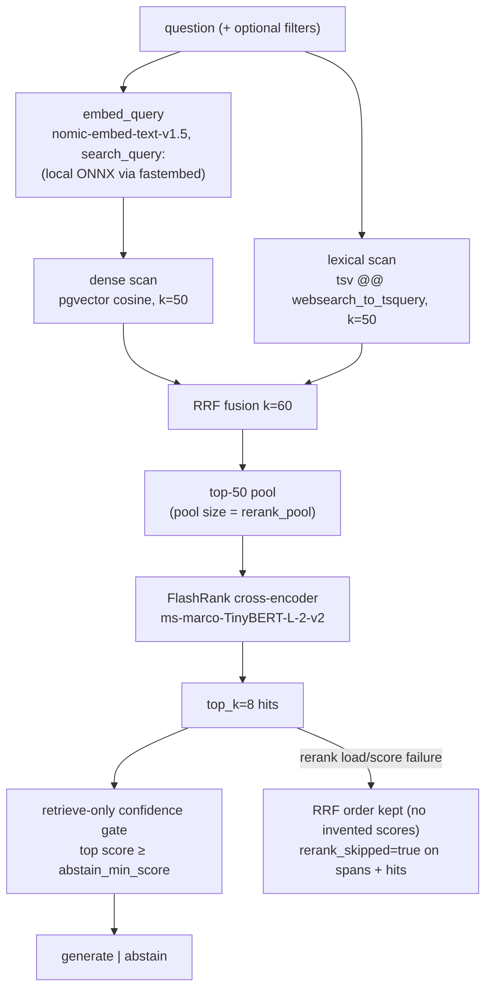

# Search Retrieval + Eval Architecture

> The retriever is a measured component, not a vibe. This doc explains **how
> retrieval runs, how it is scored, and which retrieval decisions are binding** —
> with real, artifact-backed numbers. Companion docs: [`ARCHITECTURE.md`](ARCHITECTURE.md)
> (whole system), [`DECISIONS.md`](../DECISIONS.md) (binding choices),
> [`docs/contracts/hybrid-retrieval.md`](contracts/hybrid-retrieval.md) (Contract C).

## Contents

- [Retriever pipeline](#retriever-pipeline)
- [Query-time knobs](#query-time-knobs)
- [Why hybrid retrieval](#why-hybrid-retrieval)
- [The reranker contract](#the-reranker-contract)
- [Metadata filters](#metadata-filters)
- [Latency budget](#latency-budget)
- [Retrieval evaluation (qrels)](#retrieval-evaluation-qrels)
- [Answerability calibration](#answerability-calibration)
- [Answer/abstain gates (RAGAS)](#answerabstain-gates-ragas)
- [Red team](#red-team)
- [Artifacts registry](#artifacts-registry)
- [Retrieval decision log](#retrieval-decision-log)
- [Change protocol](#change-protocol)

## Retriever pipeline

Implementation: `apps/api/citebench_api/retrieval/retrieve.py` (`retrieve()`,
`rrf_fuse()`, `search_vector()`, `search_fts()`, `Filters`) and
`apps/api/citebench_api/retrieval/rerank.py` (one process-cached ranker per
`(model, max_length)` pair).

The evaluation code lives in `citebench/eval/retrieval.py` (qrels loader,
`evaluate()`, `run_variant()`, `calibration()`) — deliberately outside the API
package so the eval import surface stays small.

## Query-time knobs

| Knob | Default | Defined in | Notes |
|---|---|---|---|
| `dense_k` / `lexical_k` | 50 / 50 | `config.yaml` | both pools feed RRF (aliases `vector_k`/`fts_k`) |
| `rrf_k` | 60 | `config.yaml` | Cormack RRF constant; sweep 10/60/100 measured insensitive on this split — keep 60 |
| `rerank_pool` | 50 | `config.yaml` | measured ablations: 30/20/10 all lose recall — keep 50 |
| `rerank_model` | `ms-marco-TinyBERT-L-2-v2` | `config.yaml` | measured better AND ~7x faster than MiniLM-L-12-Q |
| `rerank_max_length` | 512 | `RetrieveConfig` | FlashRank n_ctx; 256/128 measured worse |
| `ts_config` | `english` | `RetrieveConfig` | text-search config; `simple` measured worse (MRR −0.025, overlap collapse) |
| `ts_prefix_last` | `false` | `RetrieveConfig` | `:*` on the last lexeme for truncated terms; measured neutral, kept as knob |
| `retrieval_mode` | `hybrid` | `RetrieveConfig` | `dense` / `lexical` exist for eval comparison only |
| `rerank_enabled` | `true` | `RetrieveConfig` | `false` is the "RRF only" comparison variant |
| `top_k` | 8 | `config.yaml` | hits returned; citation budget of the generator |
| `abstain_min_score` | 0.12 | `config.yaml` | retrieve-only gate; skipped when `rerank_skipped=true` |
| `filters` | none | request body | plan 017, see below |

Index-time knobs (changing these requires re-ingestion): `chunk_size 512 / overlap 64`
(`cl100k_base`), embedding `nomic-embed-text-v1.5` (768-d). Re-ranking happens
at query time only — swapping the rerank model is **not** a re-ingestion.

## Why hybrid retrieval

Measured on the committed qrels (`evals/results/retrieval.json`, record
`retr-20260914T195400Z`, k=8, 26 answerable rows):

| Variant | Recall@8 | MRR | nDCG@8 |
|---|---|---|---|
| **hybrid + rerank (baseline)** | **0.9231** | **0.7205** | **0.7687** |
| hybrid, no rerank | 0.8462 | 0.5279 | 0.5885 |
| dense only | 0.9231 | 0.6955 | 0.7560 |
| lexical only | 0.6154 | 0.4647 | 0.5033 |

- Dense alone matches recall but loses MRR/nDCG; lexical-only collapses to
  0.6154 recall. The fused pool then lets the cross-encoder do the ranking.
- RRF merges rank positions (comparable scales), which is why it happens
  **before** the reranker and not after.

## The reranker contract

- **FlashRank is optional at load time, mandatory at ordering time**: if the
  ranker fails to load or to score the pool, the pipeline never invents order —
  it falls back to the RRF list, and every hit, the rerank span, and
  `RunTrace.rerank_skipped` say so. A silent skip is a contract violation
  (`citebench_api/retrieval/retrieve.py` + `tracing/trace.py::validate_run_trace`).
  This is why the answerability gate is skipped while `rerank_skipped` is true:
  RRF and FlashRank scores are different scales; comparing them would make
  "low confidence" a lie.
- `flashrank_rerank()` raises `RerankError` if the ranker omits any input index
  (partial scores are never silently truncated).
- Model choice is **measured, not vibes** — see the decision log.

## Metadata filters

Plan 017: a `Filters` model adds parameterized constraints **to both pools
before fusion**:

| Field | SQL |
|---|---|
| `product`, `doc_type`, `source`, `license`, `origin`, `section` | `AND <col> = %s` |
| `version` | `AND COALESCE(d.version, d.version_or_snapshot) = %s` |
| `doc_ids` | `AND d.id = ANY(%s)` |

Values are always bound parameters; clause strings are f-string fragments with
no user data, so injection is out by construction. The Playground exposes two
of these (product, doc_type) via native selects sourced from
`GET /corpus/facets`.

## Latency budget

`scripts/bench-retrieve.py` (local, needs Postgres + model caches; **not** a CI
command) measures retrieve-only latency under a named `RetrieveConfig`
override (`--variant '{"rerank_pool": 20}'`). Current artifact
`evals/results/retrieve-bench.json` (`measured-under-retrieve-bench-2026-09-15`,
n=50, 31,288 chunks):

| Quantity | Value |
|---|---|
| p50 | 302.7 ms |
| **p95** | **352.9 ms** (budget 400 ms) |
| rerank stage | ~100.7 ms |
| dense scan | ~135.8 ms (brute-force pgvector, **no ANN index**) |
| lexical (FTS) | ~5.4 ms |
| query embedding | ~18.6 ms |

Decisions behind the number:

1. **ANN/HNSW stays deferred.** An index targets the 125 ms scan; the budget
   is already met and the scan is not dominant (the cross-encoder was, at
   2,180 ms, before the TinyBERT swap). Revisit only if a future bench shows
   the scan dominating.
2. After any pool/rewrite/parse change that moves stage costs, re-run the bench
   and update the artifact — latency claims are never hand-typed.

## Retrieval evaluation (qrels)

- Split: `evals/splits/retrieval.jsonl` — 26 answerable (with `gold_doc_ids`)
  + 8 unanswerable rows, authored by hand against the frozen corpus.
- Scored **retrieval-only** (no LLM): `python -m citebench.eval.retrieval`.
- Definitions (document-level; `top_k=8` hits → distinct `doc_id`s):
  - **Recall@k** — fraction of rows with at least one gold doc in the top k.
  - **MRR** — mean of `1 / rank` of the first gold doc (0 if absent).
  - **nDCG@k** — binary-gain DCG / ideal DCG over the k hits.
- Scored variant runs (`--compare`) are part of the artifact, each one a full
  retrieval pass under a named `RetrieveConfig` override (the table in
  [Why hybrid retrieval](#why-hybrid-retrieval)).

## Answerability calibration

The same run also records the **retrieval-only answerability matrix**: for every
row, the gate (top hit score ≥ `abstain_min_score`; skipped when rerank is
skipped) decides answered vs abstained.

- **false-answer rate** — gate answered an unanswerable question: **0.000**
  (was 0.250 under the previous MiniLM scoring scale).
- **false-abstain rate** — gate abstained on an answerable question: **0.000**
  (26/26 answerable rows confident; 8/8 unanswerable abstained with reason
  `low_confidence`).

A threshold change to `abstain_min_score` re-measures this; it is a calibration
change, not a free tweak — see `calibration()` in `citebench/eval/retrieval.py`.

## Answer/abstain gates (RAGAS)

Answer-level faithfulness is scored by RAGAS over collected live answers; the
judge is Groq-hosted (`openai/gpt-oss-20b`). The runtime and the judge cannot
share a dependency set (ragas conflicts with runtime pins), so the flow is
decoupled (`scripts/live-evals.sh`):

1. `citebench.eval.answers` (runtime venv) collects grounded answers to
   `ci.jsonl` — 20 rows; **mock mode replaces Groq with fixture rows** and is
   what CI always runs.
2. `citebench.eval.live_score` (eval venv `.venv-eval`, ragas 0.2 + local nomic
   for context embeddings) writes `evals/results/live.json` with
   `mode=live`, `judge_model`, `measured_at`, and the gate decision.
3. Gate: **faithfulness ≥ 0.7** (`threshold_faithfulness` in `config.yaml`).

Metrics reported: `faithfulness`, `context_precision`, `answer_relevancy`.
A failed judge call never invents a number — the metric is recorded `null` and
`gate_reason` says why. Live runs need `GROQ_API_KEY`; the Groq free tier's
200k tokens/day window has twice interrupted the live a number production of
this artifact, in which case the run is **re-run later, not faked**.

## Red team

`evals/redteam.jsonl` (10 cases: payrolls, passwords, invented citations,
out-of-corpus facts...) verifies the **refusal** promise. Expected outcome is
abstention/block (`expect_block`), scored id + pass per case; CI runs it in
mock, live via the same script (`citebench/eval/redteam.py`). Every attack row
`blocked=True` — currently 10/10 — and unanswerable known-bad split
(`known_bad.jsonl`) abstains clean.

## Artifacts registry

Committed, method-tagged; each carries `measured_at`/`measured_under` and what
produced it. **No artifact without its tag; no hand-typed number in docs.**

| Artifact | Producer | Consumer |
|---|---|---|
| `evals/results/latest.json` | mock RAGAS (CI) / live flow fallback | `/evals` answer panel, `/metrics` |
| `evals/results/live.json` | `live_score.py` (RAGAS + Groq judge) | CI live gate |
| `evals/results/retrieval.json` | `python -m citebench.eval.retrieval` | `/evals` retrieval panel ("Run comparison" re-runs it) |
| `evals/results/retrieve-bench.json` | `scripts/bench-retrieve.py` | latency budget / ANN decision |
| `evals/results/redteam.json` | `citebench/eval/redteam.py` | `/evals` redteam panel |
| `evals/results/rewrite-ablation.json` | `scripts/rewrite-ablation.py` | plan 019 keep-or-delete report |

## Retrieval decision log

| # | Decision | Basis | Where |
|---|---|---|---|
| 1 | Hybrid (dense + lexical, RRF k=60) before rerank | contract C; lexical alone collapses | `DECISIONS.md` C2, `docs/contracts/hybrid-retrieval.md` |
| 2 | Cross-encoder over the fused pool, `top_k=8` only for the generator | quality of rerank > `RRF` scale mixing | `DECISIONS.md` C3 |
| 3 | Default reranker = **ms-marco-TinyBERT-L-2-v2** | qrels recall 0.904→0.923, MRR 0.616→0.721, nDCG 0.692→0.769, rerank 2180→98 ms; measured, not vibes | `DECISIONS.md` "Retrieve latency at scale" update (2026-09-14) |
| 4 | Keep `rerank_pool=50` and `max_length=512` | pool 30/20/10 and ctx 256/128 all lose the gate metrics | plan 023 ablation |
| 5 | Any deployed rerank change is proven on the qrels (recall ≥ 0.894, nDCG ≥ 0.682) and scored silently to the artifact | a bench does not trade quality for speed silently | plan 023 |
| 6 | No ANN (HNSW/IVFFlat) yet | dense scan ~125 ms vs 400 ms budget; scan is not the bottleneck | `DECISIONS.md`, re-checked at 31,288 chunks |
| 7 | `rerank_skipped` fallback visible on every span + hit | silent skip would manufacture order | `DECISIONS.md` C3, Contract B tests |
| 8 | Metadata filters are bound parameters over the documents/chunks join | correctness + safety | plan 017 |
| 9 | Retrieval metrics are document-level on hand-labeled qrels; artifact is the evidence | claims can't exceed the split's size (26 answers): a 1-row flip ≈ ±0.038 recall | `evals/results/retrieval.json` |
| 10 | Query rewrite (plan 019) is flag-gated default-off and must win its live ablation or be **deleted** | a rewrite can pull out-of-corpus questions into the corpus | `plans/019-query-rewrite-ablation.md` |

> Provenance note (decision #3): the MiniLM-L-12-Q baseline (0.904 / 0.616 /
> 0.692, false-answer 0.250) was measured in a 2026-09-13 local run whose
> MiniLM arm is not committed, so that baseline is not independently
> reproducible from the repo. The TinyBERT numbers are, in
> `evals/results/retrieval.json`.

## Change protocol

1. Change the knob/pool/model in one place only (`config.yaml` or code default).
2. Re-run `python -m citebench.eval.retrieval --compare` and commit the refreshed
   artifact **plus** an updated variant row showing the delta.
3. Quality gate: Recall@8 ≥ 0.894, nDCG@8 ≥ 0.682, false-answer ≤ 0.250,
   false-abstain = 0.000. Lower thresholds require a new, approved decision.
4. Re-run `scripts/bench-retrieve.py --n 50` (or `--variant` for a specific
   model) and check p95 against the 400 ms budget.
5. Update the artifact row/method tag + `DECISIONS.md` + this doc. If a claim
   retires (e.g. "over budget"), remove the claim together with the reason.

## Reviewer audit (2026-09-15) — response record

An external review flagged seven retrieval items. Verdicts, all measured (see
`DECISIONS.md` "Retrieval reviewer audit"):

| # | Review point | Outcome |
|---|---|---|
| 1 | `plainto_tsquery` weakest link; use `websearch_to_tsquery` (+prefix matching) | **Adopted** websearch (metric-neutral, graceful degradation). `:*` prefix-last = neutral knob. `simple` config rejected (MRR −0.025, overlap collapse). |
| 2 | Sweep RRF k∈{10,60,100} | Insensitive on this split → keep 60; sweep recorded in DECISIONS, not a perma-variant. |
| 3 | Log dense/lexical pool overlap as health metric | **Adopted**: retrieve span carries `dense_count`/`lexical_count`/`pool_overlap`/`pool_overlap_ratio`. Measured mean ≈ 9.4% → RRF is a union-diversifier here; watch for drift. |
| 4 | Prefer MiniLM-L-12 over TinyBERT | Already measured on our qrels; TinyBERT won all three metrics at ~7x less latency (plan 023). No change. |
| 5 | Abstain gate score is uncalibrated drift-risk | **Adopted**: gate decisions record `top_score` + `rerank_skipped` per row; recalibrate the threshold on any rerank-model change. |
| 6 | Filters should push into scans pre-fusion | Already true (plan 017): `WHERE` predicates on both scans. |
| 7 | Verify `search_document:` prefix at ingest | Verified in code (`embed.py`/`pipeline.py`): document prefix at ingest, `search_query:` at ask. |
| 8 | Log RRF rank vs rerank rank | **Adopted**: `rrf_rank` per hit + `rerank_max_rank_shift` on the rerank span. |

Library references: pgvector / Postgres FTS / FlashRank / fastembed / RAGAS
links live in [`ARCHITECTURE.md`](ARCHITECTURE.md#libraries-and-packages).

## Limitations

Read these before quoting a number out of context:

- The qrels split is **34 questions total** — 26 answerable (30 gold doc ids) and
  8 unanswerable. 22 of the 26 answerable rows carry a single gold doc, so
  Recall@8 is effectively hit-rate@8; a one-row flip moves recall by ~0.038.
- The abstain threshold was calibrated **in-sample** on those same 8
  unanswerable rows; there is no held-out calibration split. Treat the
  false-answer/false-abstain rates as fit-on-the-split, not as an independent
  generalization estimate.
- The CI "faithfulness" is a **mock fixture judge** whose contexts are the
  answer itself (`citebench/eval/pipeline.py` `_fixture`), so it is a pipeline
  sanity check — not a measurement — and cannot fail below the 0.7 gate. The
  real judge is the live RAGAS path (`make evals-live`), which runs only when
  `GROQ_API_KEY` is present.
